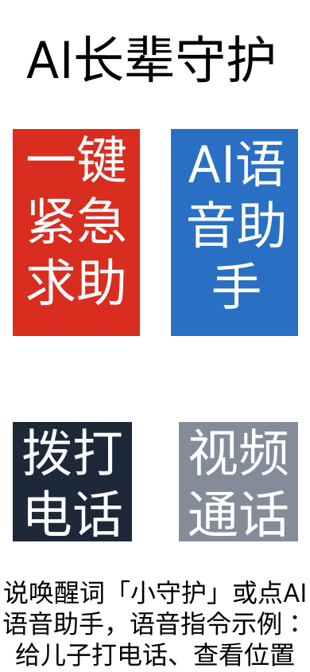
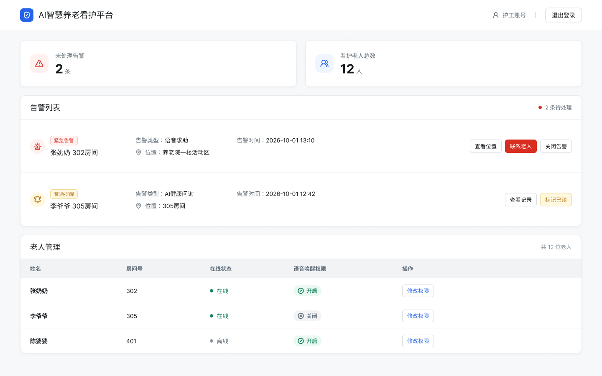

# AI长辈守护｜B端养老看护平台
C端老人适老化APP + B端养老机构看护后台

## 项目简介
面向养老机构的智慧看护平台，包含老人使用的C端极简适老化APP，以及护工使用的B端管理后台。
解决核心痛点：
1. 老人端：普通APP字体小、广告多、操作复杂，老人看不清、容易误点广告，基础通讯、求助操作门槛高。
2. 机构端：一名护工同时照看十几位老人，无法实时掌握老人位置、身体异常情况，告警信息滞后。

## 在线作品集网页
👉 [AI长辈守护 项目主页](https://DavidGan0172.github.io/ai-elderly-care-platform/)
>  项目网页源码：[index.html](./index.html)


### C端APP界面预览



### B端护工Web后台预览

> B端为网页SaaS工作台，护工电脑浏览器登录使用。MVP仅完成首页仪表盘可视化原型，用于查看老人统计、处理告警、管理老人语音唤醒权限；老人档案、健康记录、告警历史等模块纳入二期迭代规划。

## Figma原型链接
[Figma交互式原型](https://www.figma.com/design/lfdO5SuwuzP0O8NkecVu2U/Untitled?node-id=0-1&t=vAdyGG38jXRfNnL8-1)

## 用户角色
1. C端：养老院老人（视力衰退、记忆力弱，部分存在口齿不便）
2. B端：养老机构护工、机构管理员

## C端APP首页核心功能
- 一键紧急求助：一键向护工、家属推送告警消息与老人实时位置
- AI语音助手：**双触发交互逻辑**
   方式1：手动点击「AI语音助手」按钮，进入AI聆听页面
   方式2：APP处于前台运行状态，说出唤醒词【小守护】，直接唤起AI聆听
   页面底部提示文案：说唤醒词「小守护」或点AI语音助手，语音指令示例：给儿子打电话、查看位置
- 拨打电话：超大字体一键拨号入口
- 视频通话：和家属发起视频通话

两套使用路径并行：
① 手动触屏模式：全部功能都支持点击操作，不需要使用语音
② 语音指令模式：需要先触发AI聆听（点击按钮 / 喊唤醒词），之后下达语音指令

## 产品约束
1. 语音唤醒**仅APP前台生效**；APP切后台、锁屏后自动关闭收音，兼顾省电、隐私保护、防止误触发。
2. B端后台支持护工单独开关老人账号的语音唤醒功能；针对认知障碍老人，可直接关闭语音唤醒，仅保留手动点击操作模式。

## B端后台能力
- 老人实时位置监控、电子围栏越界告警
- 健康异常信息接收与告警
- 历史告警、通话记录查询
- 账号权限管理：开启/关闭单个老人账号的语音唤醒能力
> MVP阶段可视化原型仅实现首页仪表盘，其余能力完成需求方案设计，二期落地。

## 项目亮点
1. 适老化无障碍设计：超大字体、高对比度配色、大圆角按钮，降低老人识别负担
2. 双触发交互设计：兼顾口齿正常可以语音唤醒的老人，以及口齿不清、环境嘈杂只能手动点击的老人
3. B+C联动设计：C端采集老人位置、告警数据，B端机构后台统一管理，满足养老院业务管理诉求

## 📁 仓库文件结构
```
ai-elderly-care-platform/
├─ img/                      # 原型图片资源
├─ index.html                # 项目作品集网页（在线预览入口）
├─ README.md                 # 仓库说明（当前文档）
├─ prd.md                    # 产品需求文档
├─ competitor.md             # 竞品分析文档
├─ prototype.md              # Figma 原型说明文档
├─ flow.md                   # 业务流程图说明
├─ interaction.md            # 交互逻辑说明
└─ conclusion.md             # 项目复盘总结
```